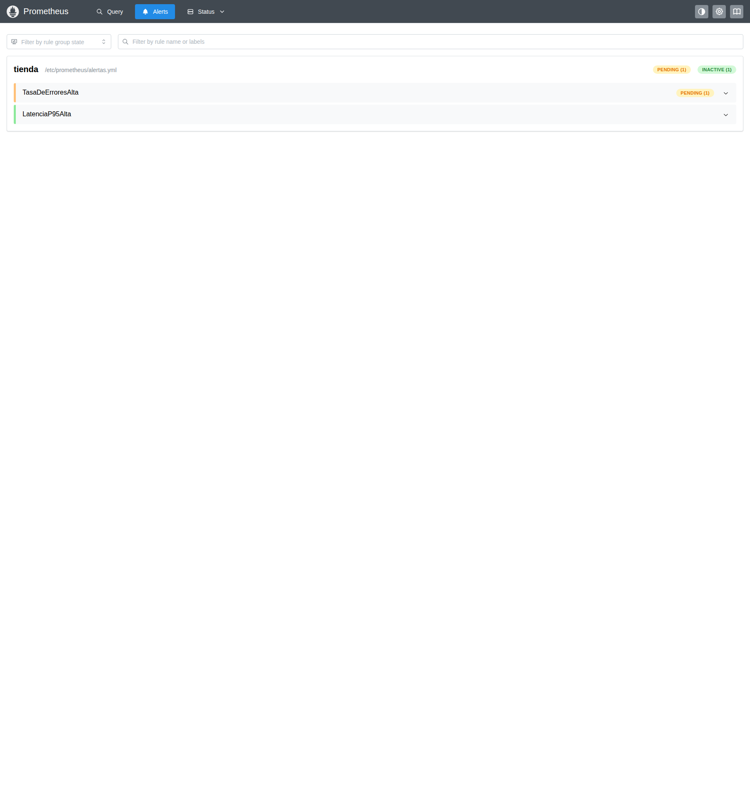
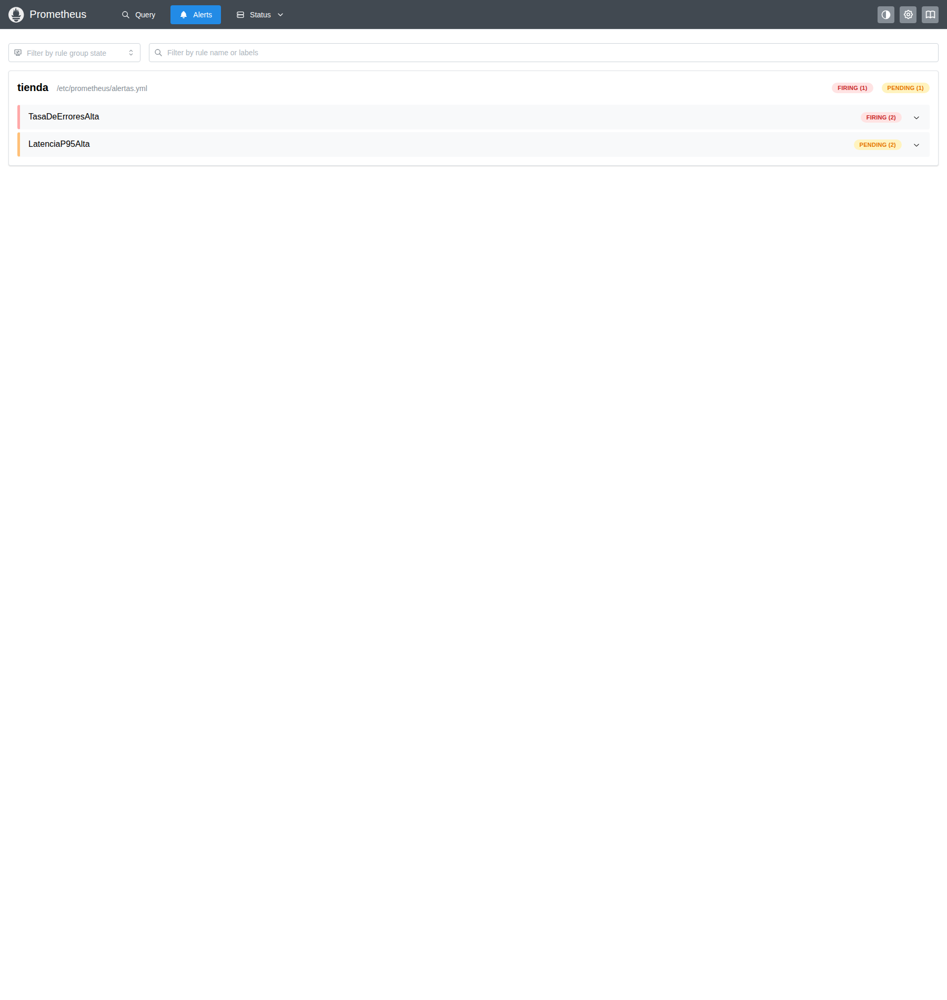
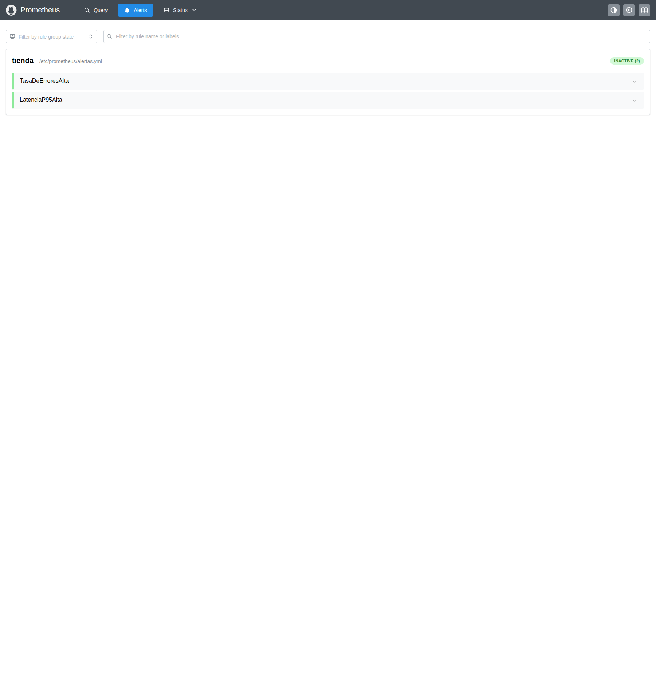

# Alertas y recuperación

Las reglas originales de `prometheus/alertas.yml` se mantienen sin reducir sus umbrales
ni el tiempo requerido para dispararse. Se evalúan cada cinco segundos.

| Regla | Condición | Tiempo continuo |
|---|---|---|
| `TasaDeErroresAlta` | Proporción de respuestas 5xx mayor que 0,05 | 30 segundos |
| `LatenciaP95Alta` | p95 mayor que 0,5 segundos | 30 segundos |

Ambas consultas usan una ventana de un minuto y agrupan por `application`. Puede
haber una instancia por cada servicio. La tasa de errores configurada en el simulador
es una probabilidad por operación, no una garantía de que ambos servicios mostrarán
exactamente el mismo porcentaje HTTP.

## Ciclo observado el 8 de noviembre de 2026

El estado inicial de las dos reglas era Inactive. Se mantuvo k6 activo durante las
fases de error, latencia y recuperación. Los tiempos siguientes indican cuándo
el colector observó cada estado, no el instante exacto en que empezó la condición.

| Evento | Instante observado | Resultado |
|---|---|---|
| `TasaDeErroresAlta` · Pending | 18:35:38 Bogotá (23:35:38 UTC) | inventario: pending |
| `TasaDeErroresAlta` · Firing | 18:36:09 Bogotá (23:36:09 UTC) | inventario: firing, pedidos: pending |
| `LatenciaP95Alta` · Pending | 18:36:44 Bogotá (23:36:44 UTC) | inventario: pending, pedidos: pending |
| `LatenciaP95Alta` · Firing | 18:37:13 Bogotá (23:37:13 UTC) | inventario: firing, pedidos: firing |
| Ambas reglas · Inactive | 18:38:30 Bogotá (23:38:30 UTC) | Sin instancias activas |

La regla de errores alcanzó primero Firing para inventario; pedidos aún estaba Pending
en esa primera captura porque cruzó su umbral después. La instantánea posterior,
tomada al observar Pending en la regla de latencia, confirma **ambas instancias de
errores en Firing**. No se asumió simultaneidad entre servicios.

Cada instancia conserva su propio `activeAt`. El `for: 30s` se cuenta desde ese estado
interno y las reglas se evalúan cada cinco segundos; no desde el primer sondeo del
colector. Los archivos JSON guardan ambos datos para explicar diferencias entre
los tiempos observados y la duración exacta de la condición.

## Fallas y recuperación

1. Se configuró `tasaError=0.3`: inventario devolvió 500 en operaciones fallidas y
   pedidos tradujo las fallas de su dependencia a 503. La consulta de errores midió
   26,27% en inventario y 15,84% en pedidos durante esta fase.
2. Se reemplazó esa configuración por `latenciaMs=800`, que restableció la tasa de
   errores a cero. El p95 medido superó 500 ms en ambos servicios y activó la regla
   de latencia. Las ventanas todavía contenían algunas muestras de errores anteriores.
3. A las **18:37:29 Bogotá (23:37:29 UTC)** se restableció el simulador con DELETE.
   Su consulta posterior confirmó `latenciaMs=0` y `tasaError=0`.
4. A las **18:38:30 Bogotá (23:38:30 UTC)** ambas reglas estaban Inactive. La consulta
   instantánea posterior devolvió una proporción 5xx de cero para los dos servicios.

La confirmación del DELETE no se usó por sí sola como prueba de recuperación: se
esperó a que las ventanas y las alertas reflejaran el retorno a la normalidad.

## Capturas originales

Errores: Pending

[Instantánea completa de reglas](https://github.com/ItsN3M3515/DYAS-Monitoreo/blob/main/evidence/runtime/alert-TasaDeErroresAlta-pending.json).

Errores: primera instancia en Firing

[Instantánea completa de reglas](https://github.com/ItsN3M3515/DYAS-Monitoreo/blob/main/evidence/runtime/alert-TasaDeErroresAlta-firing.json).

Latencia: Pending; ambas instancias de errores ya en Firing

[Instantánea completa de reglas](https://github.com/ItsN3M3515/DYAS-Monitoreo/blob/main/evidence/runtime/alert-LatenciaP95Alta-pending.json).

Latencia: ambas instancias en Firing

[Instantánea completa de reglas](https://github.com/ItsN3M3515/DYAS-Monitoreo/blob/main/evidence/runtime/alert-LatenciaP95Alta-firing.json).

Ambas reglas de nuevo Inactive

[Reglas iniciales](https://github.com/ItsN3M3515/DYAS-Monitoreo/blob/main/evidence/runtime/alerts-baseline.json) · [Recuperación](https://github.com/ItsN3M3515/DYAS-Monitoreo/blob/main/evidence/runtime/alerts-recovered.json) · [Timeline UTC](https://github.com/ItsN3M3515/DYAS-Monitoreo/blob/main/evidence/runtime/timeline.json).

El [dashboard del mismo intervalo](Dashboard) conserva el panel de errores por encima
de su referencia del 5%. El stack muestra las alertas en Prometheus; no incluye
Alertmanager ni notificaciones externas, que son retos opcionales.
