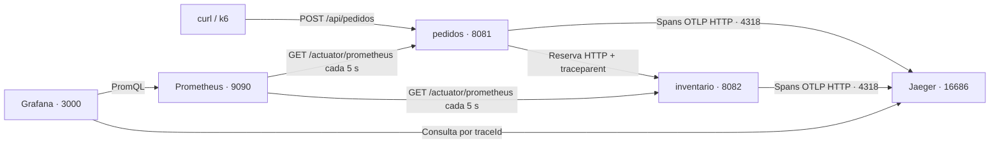

# Arquitectura de observabilidad

## Recorrido de una solicitud

Las flechas indican quién inicia la comunicación. Prometheus solicita las métricas;
las aplicaciones envían sus trazas a Jaeger. Grafana consulta esas fuentes para
presentar la información, pero no recolecta directamente las métricas de Java.

## Aplicación

El proyecto se compila una vez y produce `target/tienda.jar`. El Dockerfile construye
una imagen común. Docker Compose arranca dos contenedores de esa imagen y selecciona
el servicio con `SPRING_PROFILES_ACTIVE`:

| Perfil | Responsabilidad | Estado mantenido |
|---|---|---|
| `pedidos` | Validar solicitudes, reservar inventario, crear y consultar pedidos | Pedidos en memoria e identificador secuencial |
| `inventario` | Consultar stock, reservar unidades y simular fallas | Stock en memoria y configuración de fallas |

No hay base de datos: reiniciar el proceso de un servicio pierde su estado de negocio.
Cada servicio tiene su propia JVM; compartir una imagen no significa compartir memoria.

`PedidoController` recibe la petición y delega en `PedidoService`. Este último utiliza
la interfaz `InventarioCliente`; `InventarioClienteHttp` implementa la llamada real.
El cliente HTTP se construye con el `RestClient.Builder` que configura Spring Boot para
preservar la instrumentación y propagar el contexto de traza.

Inventario actualiza el stock con operaciones atómicas, para evitar que dos reservas
simultáneas descuenten las mismas unidades. `SimuladorFallas` se ejecuta antes de las
consultas y reservas: puede añadir una espera y lanzar errores aleatorios.

## Responsabilidad de cada herramienta

| Componente | Función en este taller |
|---|---|
| Actuator | Expone salud y métricas mediante HTTP |
| Micrometer | Registra métricas HTTP, JVM y de negocio |
| Prometheus | Guarda series temporales, permite consultas y evalúa alertas |
| Grafana | Muestra el dashboard aprovisionado desde archivos JSON y YAML |
| OpenTelemetry | Representa y exporta los spans de cada operación |
| Jaeger | Recibe trazas y permite inspeccionar el recorrido y duración de una petición |
| k6 | Mantiene tráfico repetible para que existan datos en las ventanas de las consultas |

## Métricas, errores y trazas

`pedidos_total` cuenta resultados de negocio con las etiquetas `confirmado`,
`sin_stock`, `producto_inexistente` y `error_inventario`. `inventario_stock` muestra
las unidades disponibles por producto. Las rutas HTTP usan plantillas y no identificadores
de pedidos como etiquetas, lo que limita la cantidad de series.

`ManejadorErrores` traduce excepciones a códigos HTTP. Para errores 5xx también registra
la excepción en la observación HTTP y en el span actual: manejar una excepción y devolver
una respuesta no basta para que toda la instrumentación conozca el error original.

`TrazasConfig` filtra la exportación de spans cuya etiqueta `uri` comienza por `/actuator`.
Así las consultas periódicas de salud y métricas no dominan las búsquedas de trazas de
negocio. Sus métricas HTTP siguen existiendo; las consultas del dashboard las excluyen.

## Límites de la verificación

Las pruebas verifican lógica de negocio, respuestas HTTP simuladas, filtros de trazas
y selección de componentes por perfil. El pipeline también construye la imagen y valida
configuraciones. Ninguna de esas comprobaciones sustituye levantar el stack y observar
una traza real que cruce los dos servicios.
