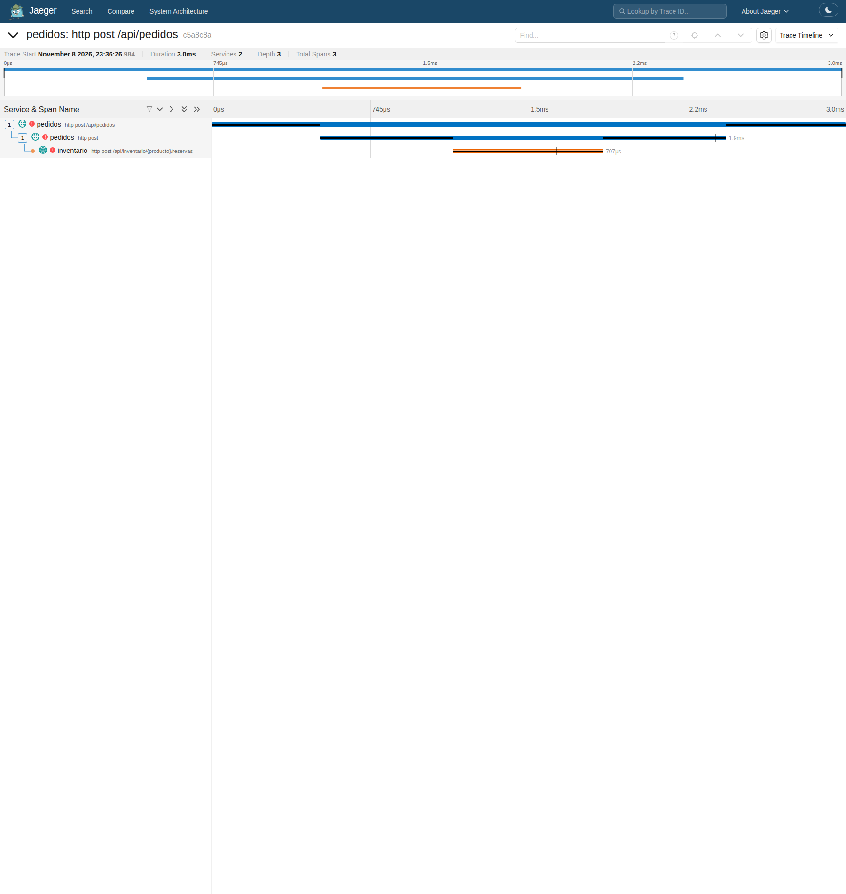

# Correlación entre métricas, logs y trazas

## Diagnóstico de una solicitud real

La regla `TasaDeErroresAlta` y el panel 5xx identificaron el intervalo de falla.
Dentro de él se seleccionó una solicitud real generada por k6 con traceId
`c5a8c8ae32a66fd74a32c9f4b1006845`. La traza, los logs y los códigos HTTP muestran esta secuencia:

1. Inventario lanzó `FallaSimuladaException` y respondió **500** a la reserva.
2. El cliente HTTP de pedidos recibió ese 500 y lanzó `InventarioNoDisponibleException`.
3. Pedidos respondió **503** al cliente. El span cliente conserva el 500 que recibió
   de inventario; el span servidor de pedidos conserva el 503 que devolvió.

## Logs correspondientes

Las líneas ocurrieron aproximadamente a las **18:36:26 Bogotá (23:36:26 UTC)**.
Se conservan a continuación sus timestamps UTC originales, sin editar el contenido.
Los traceId coinciden y los spanId son distintos, como corresponde a operaciones
separadas dentro de la misma traza.

### Pedidos

```text
pedidos-1  | 2026-11-08T23:36:26.986Z ERROR 1 --- [pedidos] [nio-8081-exec-1] [c5a8c8ae32a66fd74a32c9f4b1006845-941f765843d84abf] e.u.dyas.tienda.comun.ManejadorErrores   : Error al atender la solicitud: El inventario respondió 500
```

### Inventario

```text
inventario-1  | 2026-11-08T23:36:26.985Z ERROR 1 --- [inventario] [nio-8082-exec-2] [c5a8c8ae32a66fd74a32c9f4b1006845-06d60fd255d1cbe0] e.u.dyas.tienda.comun.ManejadorErrores   : Error al atender la solicitud: Falla simulada en el servicio de inventario
```

## Traza en Jaeger

Los tres spans están marcados con error y forman una cadena completa. La causa original
aparece en inventario; la excepción traducida aparece en pedidos. La coincidencia
exacta del traceId permite unir los dos registros con esa petición de la traza.

<details>
<summary>Traza del mismo error en Jaeger</summary>



</details>

[Logs originales en JSON](https://github.com/ItsN3M3515/DYAS-Monitoreo/blob/main/evidence/runtime/correlated-logs.json) · [Spans y excepciones](https://github.com/ItsN3M3515/DYAS-Monitoreo/blob/main/evidence/runtime/trace-error.json).

El manejador registra explícitamente el error en la observación HTTP y en el span
actual porque intercepta la excepción. El ciclo observado fue métrica → intervalo
de falla → log de pedidos → log de inventario → traza completa, usando el mismo
identificador. El [dashboard](Dashboard) y la [secuencia de alertas](Alertas) aportan
el contexto agregado de esa petición.
