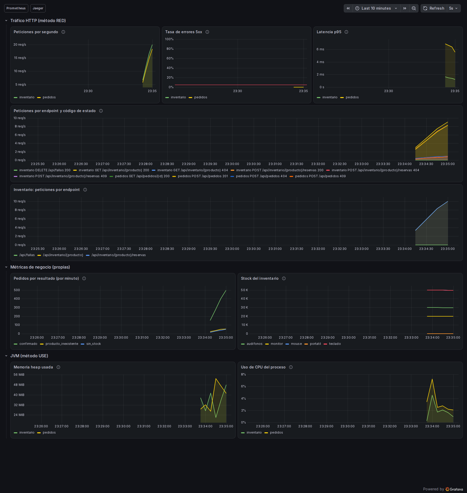
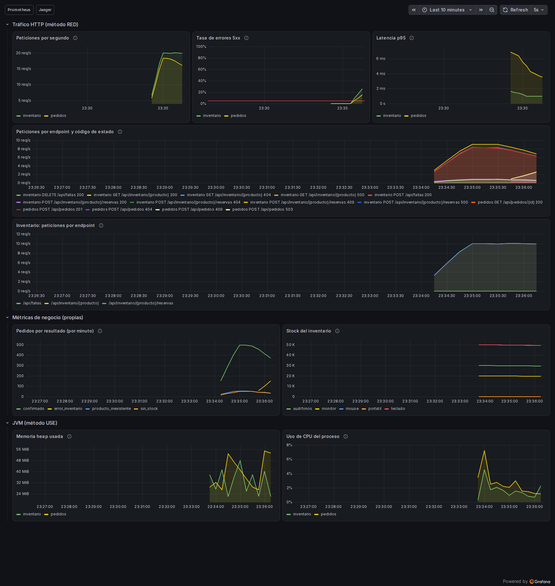
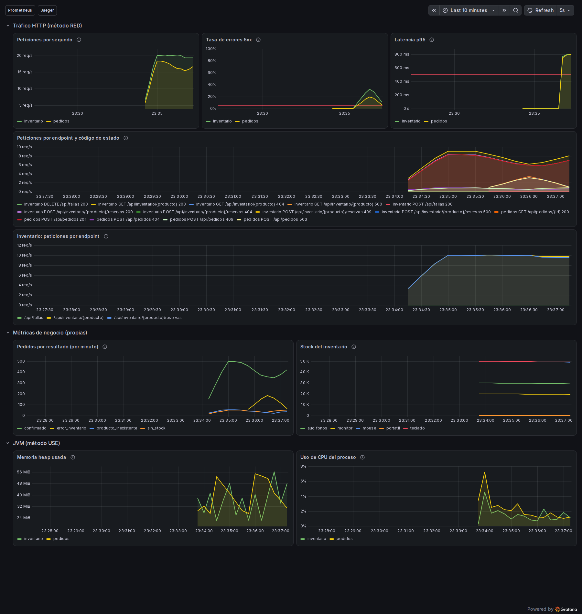
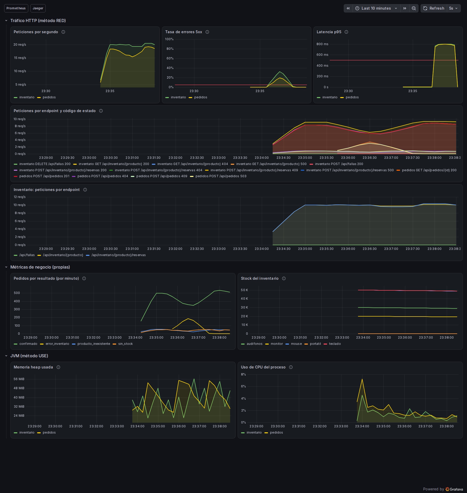

# Dashboard de Grafana

El dashboard **Tienda - Observabilidad** está definido en
[`grafana/dashboards/tienda.json`](https://github.com/ItsN3M3515/DYAS-Monitoreo/blob/main/grafana/dashboards/tienda.json).
Grafana lo carga mediante su proveedor de archivos. Las fuentes Prometheus y Jaeger
también se aprovisionan desde archivos del repositorio.

## Paneles

| Panel | Qué permite observar |
|---|---|
| Peticiones por segundo | Volumen de solicitudes por servicio |
| Tasa de errores 5xx | Proporción de fallas y umbral del 5% |
| Latencia p95 | Duración de solicitudes y umbral de 500 ms |
| Peticiones por endpoint y código de estado | Rutas y respuestas involucradas en un cambio de comportamiento |
| **Inventario: peticiones por endpoint** | Nuevo desglose del tráfico propio de inventario |
| Pedidos por resultado | Confirmaciones, falta de stock, productos inexistentes y fallas de inventario |
| Stock del inventario | Unidades disponibles por producto |
| Memoria heap usada | Memoria de objetos Java en uso por servicio |
| Uso de CPU del proceso | Fracción de CPU empleada por cada proceso |

## Panel adicional

El panel nuevo tiene identificador **12**, ocupa el ancho de la sección RED y utiliza:

```promql
sum by (uri) (rate(http_server_requests_seconds_count{application="inventario", uri!~"/actuator.*"}[1m]))
```

La leyenda identifica cada ruta. Comparar consultas de stock con reservas ayuda a
entender por qué el tráfico de inventario difiere del número de pedidos: k6 también
consulta stock directamente, y cada creación de pedido añade una reserva HTTP.

Se verificaron el JSON, los identificadores únicos y la ausencia de superposición
entre gráficos. El archivo conserva los ocho gráficos originales y añade el noveno.

## Resultado verificado

El runner inició el stack desde cero, sin una base previa de Grafana. La API devolvió
`provisionedExternalId: "tienda.json"`, el panel 12 y la misma consulta versionada en
el repositorio. Eso comprueba que el panel se obtiene de los archivos al arrancar.
La bandera `meta.provisioned` es false porque este proveedor permite ediciones en la
interfaz (`allowUiUpdates: true`); no se interpretó esa bandera como ausencia de archivo.

Las capturas finales muestran datos en los **nueve gráficos**, incluido el panel nuevo.
En la fase de errores el panel 5xx supera la referencia del 5%; con latencia artificial
sube el p95 de ambos servicios. El gráfico de errores usa una escala explícita de
0 a 100%, manteniendo la referencia del 5%, para evitar una escala automática engañosa
cuando toda la serie vale cero. Las reglas de alerta permanecen intactas.

Para verificar la recuperación se usaron las alertas Inactive, la configuración de
fallas restablecida y las consultas instantáneas. El dashboard conserva también
el historial de las fallas dentro de sus últimos diez minutos.

## Capturas con k6 activo

<details>
<summary>Dashboard normal con el panel adicional</summary>



</details>

<details>
<summary>Dashboard durante TasaDeErroresAlta Firing</summary>



</details>

<details>
<summary>Dashboard durante LatenciaP95Alta Firing</summary>



</details>

<details>
<summary>Historial del dashboard tras la recuperación</summary>



</details>

[Metadata original del dashboard aprovisionado](https://github.com/ItsN3M3515/DYAS-Monitoreo/blob/main/evidence/runtime/dashboard-provisioned.json).

## Verificación visual

Las primeras capturas de página completa omitían los canvas pese a que estos contenían
píxeles. Un diagnóstico comparó viewport, canvas y aceleración GPU: el viewport
conservaba las líneas y ejes en ambos navegadores. Las capturas de la entrega usan
un viewport de 1800 × 1900, comprueban píxeles dibujados y se revisaron visualmente.
No se dibujaron gráficos sustitutos ni se modificaron las imágenes para simular datos.
