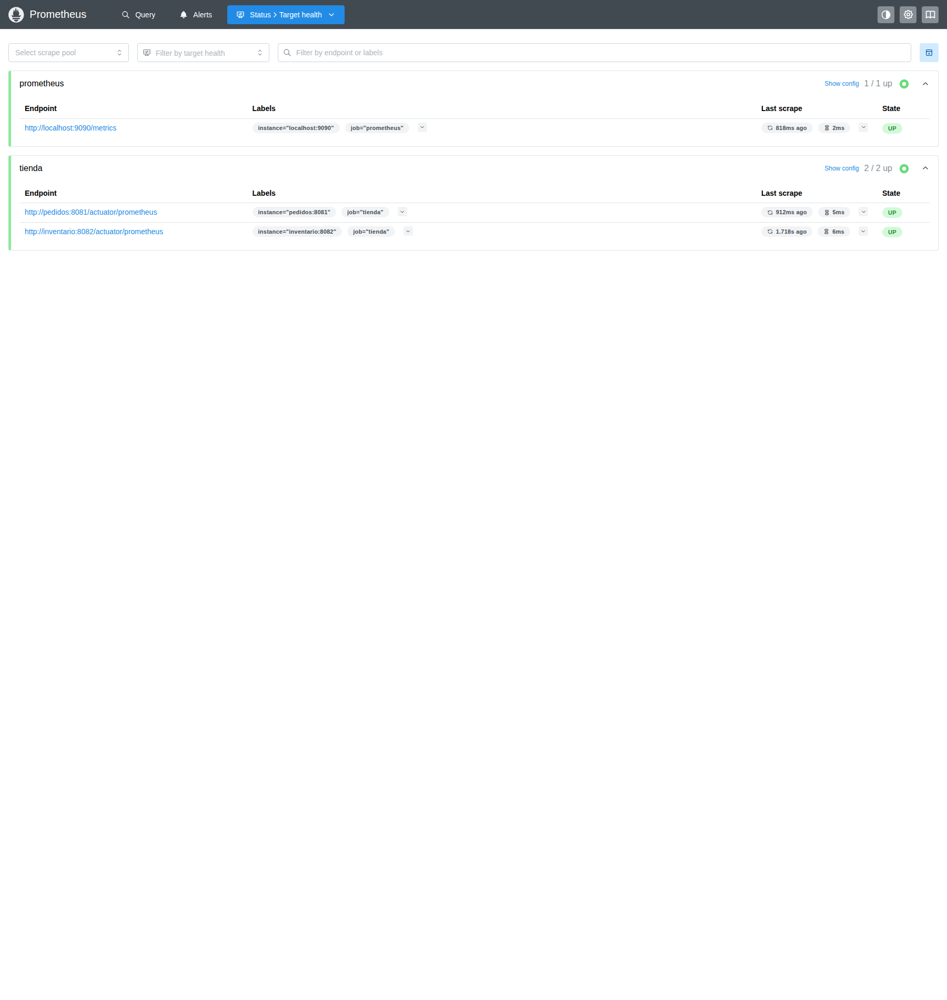
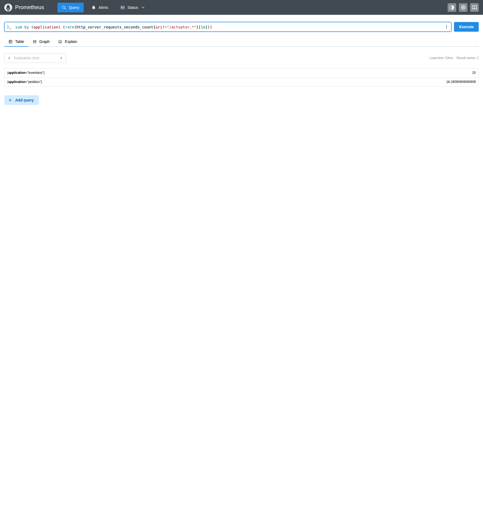
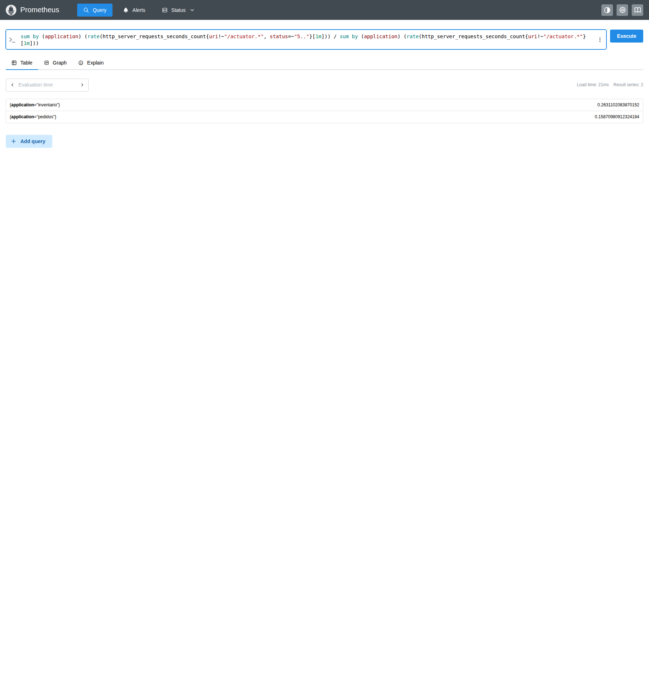
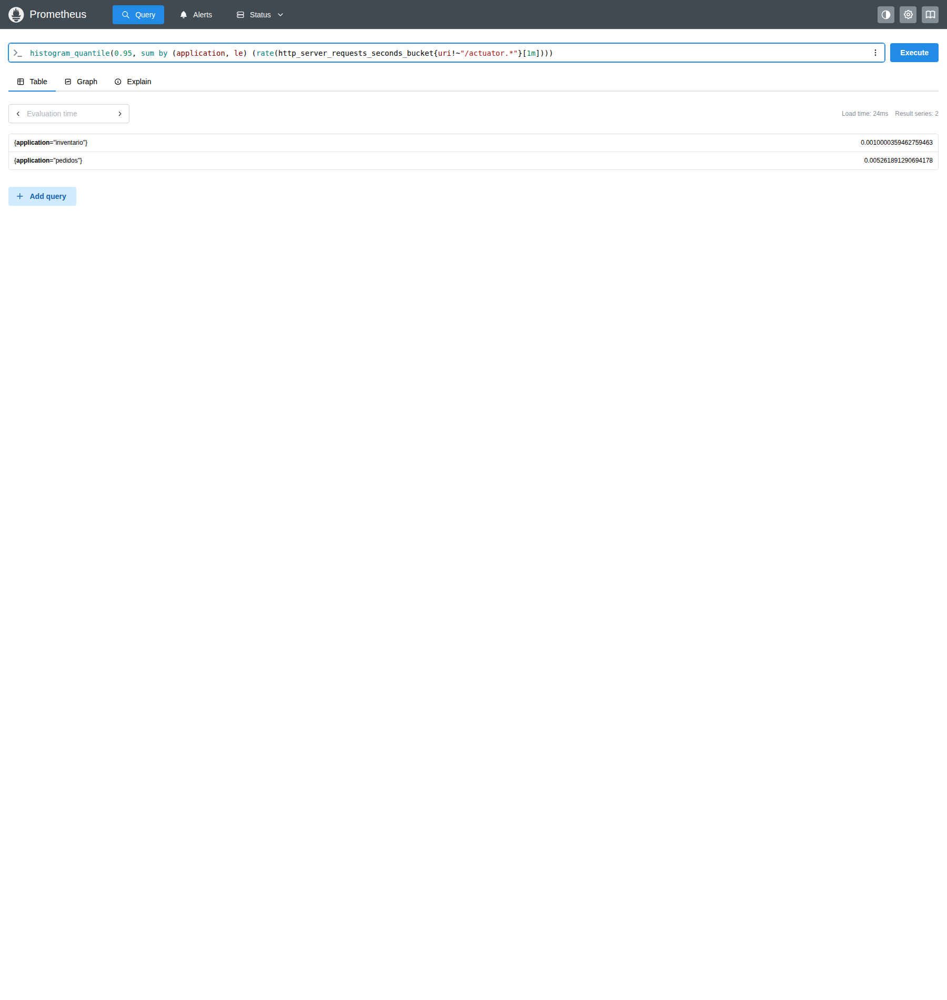
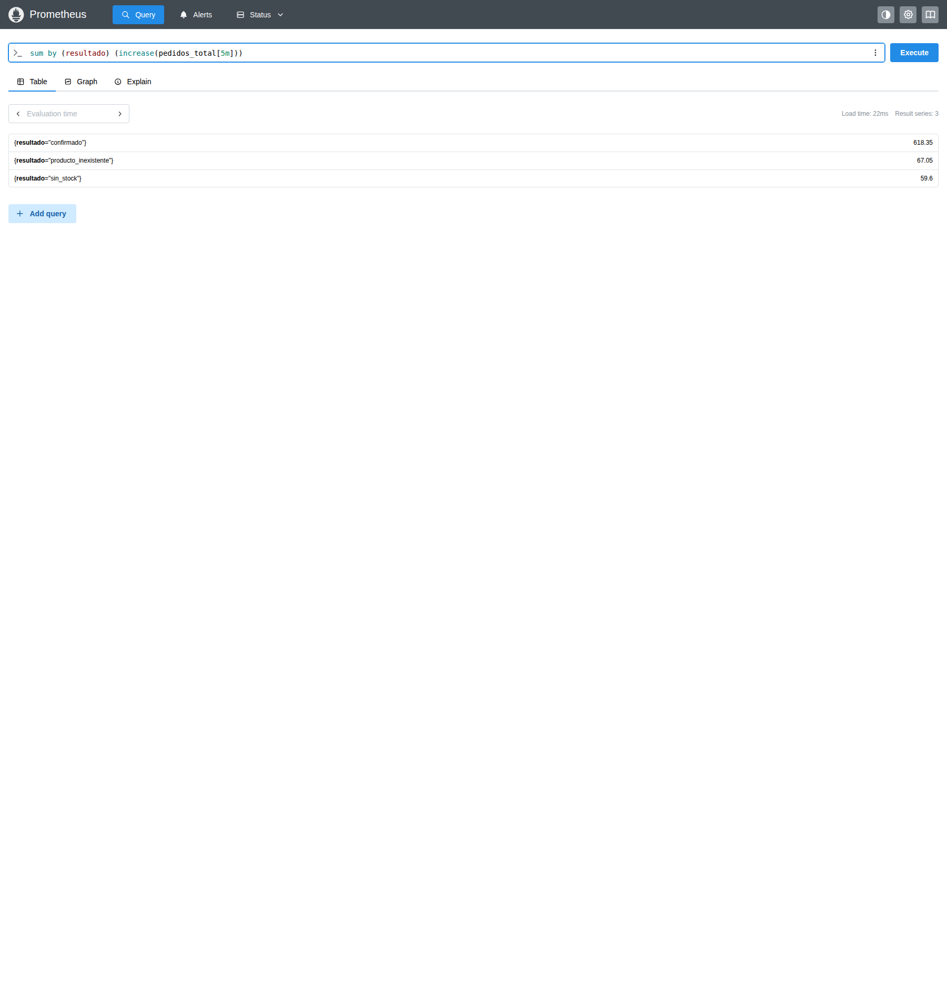

# Métricas y PromQL

**Ejecución verificada:** [run 42535601486](https://github.com/ItsN3M3515/DYAS-Monitoreo/actions/runs/42535601486), el 8 de noviembre de 2026,
en un runner aislado de GitHub. Los resultados JSON y las capturas originales están
versionados en `evidence/runtime/`. Las tablas redondean los resultados; los archivos
conservan los valores completos y el instante UTC de cada consulta.

## Targets

En `http://localhost:9090/targets`, los targets `pedidos:8081` e `inventario:8082`
del job `tienda` deben aparecer en **UP**. Esto prueba que Prometheus puede leer sus
métricas; no garantiza que todo su comportamiento de negocio sea correcto.

## Consulta 3: peticiones por segundo

```promql
sum by (application) (rate(http_server_requests_seconds_count{uri!~"/actuator.*"}[1m]))
```

Mide el incremento por segundo del contador HTTP durante el último minuto y agrupa
las rutas de cada servicio. Excluye salud y métricas. No es el número de usuarios ni
de pedidos: una iteración de k6 hace varias solicitudes.

## Consulta 5: proporción de errores 5xx

```promql
sum by (application) (rate(http_server_requests_seconds_count{uri!~"/actuator.*", status=~"5.."}[1m]))
/
sum by (application) (rate(http_server_requests_seconds_count{uri!~"/actuator.*"}[1m]))
```

Devuelve una fracción: `0.05` significa 5%, no 0,05%. Sin ninguna serie 5xx puede
devolver un resultado vacío, lo que no se debe sustituir por una medición inventada.
Se conservará también su resultado durante la fase de errores simulados.

## Consulta 6: latencia p95

```promql
histogram_quantile(0.95,
  sum by (application, le) (rate(http_server_requests_seconds_bucket{uri!~"/actuator.*"}[1m]))
)
```

Estima el p95 por servicio a partir de los buckets del histograma y devuelve segundos.
Por ejemplo, `0.8` equivaldría a 800 ms. Se necesitan tráfico y suficientes muestras
en la ventana para interpretar el valor.

## Consulta 7: pedidos por resultado

```promql
sum by (resultado) (increase(pedidos_total[5m]))
```

Estima cuántos pedidos de cada resultado hubo en los últimos cinco minutos. Es una
métrica de negocio y no incluye las consultas GET de los pedidos. `increase` puede
devolver decimales por la extrapolación entre scrapes, aunque el contador original
crezca en unidades enteras.

## Resultados medidos e interpretación

| Consulta y fase | Inventario | Pedidos | Interpretación |
|---|---:|---:|---|
| 3 · normal | 20.00 req/s | 18.29 req/s | Inventario atiende consultas directas y reservas; pedidos atiende creaciones y consultas de pedidos confirmados. No son conteos de usuarios. |
| 5 · errores | 26.27% | 15.84% | Ambos superan el umbral del 5%; el porcentaje HTTP de pedidos difiere de la probabilidad de falla por operación de inventario. |
| 6 · normal | 1.07 ms | 5.26 ms | El sistema responde por debajo del umbral de 500 ms en esta ventana. |
| 6 · latencia de 800 ms | 798.71 ms | 794.29 ms | La demora de inventario también afecta a pedidos; ambos percentiles superan 500 ms. |

Instantes de estas mediciones:

- Consulta 3, fase `baseline`: 18:35:02 Bogotá (23:35:02 UTC); [JSON original](https://github.com/ItsN3M3515/DYAS-Monitoreo/blob/main/evidence/runtime/query-3-baseline.json).
- Consulta 5, fase `errors`: 18:36:15 Bogotá (23:36:15 UTC); [JSON original](https://github.com/ItsN3M3515/DYAS-Monitoreo/blob/main/evidence/runtime/query-5-errors.json).
- Consulta 6, fase `baseline`: 18:35:07 Bogotá (23:35:07 UTC); [JSON original](https://github.com/ItsN3M3515/DYAS-Monitoreo/blob/main/evidence/runtime/query-6-baseline.json).
- Consulta 6, fase `latency`: 18:37:16 Bogotá (23:37:16 UTC); [JSON original](https://github.com/ItsN3M3515/DYAS-Monitoreo/blob/main/evidence/runtime/query-6-latency.json).
- Consulta 7, fase `baseline`: 18:35:10 Bogotá (23:35:10 UTC); [JSON original](https://github.com/ItsN3M3515/DYAS-Monitoreo/blob/main/evidence/runtime/query-7-baseline.json).

La consulta 7, en la fase normal, estimó estos pedidos por resultado:

| Resultado | `increase` de los últimos 5 minutos |
|---|---:|
| `confirmado` | 617.43 |
| `producto_inexistente` | 66.95 |
| `sin_stock` | 59.51 |

Al inicio había menos de cinco minutos de historia disponible. `increase` extrapola
entre scrapes; por eso estos resultados son estimaciones decimales, no un listado
exacto de transacciones. Durante la falla apareció también `error_inventario`.

La consulta 5 fue realmente vacía en la fase normal: aún no existían series 5xx.
Después de la recuperación devolvió **0 para ambos servicios**, porque esas series
ya existían pero habían dejado de aumentar en la ventana. No se rellenaron datos.

El p95 proviene de buckets y puede diferir de los 800 ms configurados: es una
estimación sobre una ventana y un conjunto de rutas, no la duración exacta de la
reserva individual. La traza lenta permite medir esa operación por separado.

Las capturas se tomaron unos segundos después de guardar cada JSON mientras k6
seguía activo; sus cifras pueden variar ligeramente. Ambos instantes quedan registrados.

## Capturas originales

<details>
<summary>Targets de los dos servicios en UP</summary>



</details>

<details>
<summary>Consulta 3: throughput normal</summary>



</details>

<details>
<summary>Consulta 5: proporción de errores 5xx</summary>



</details>

<details>
<summary>Consulta 6: p95 normal</summary>



</details>

<details>
<summary>Consulta 7: pedidos por resultado</summary>



</details>
