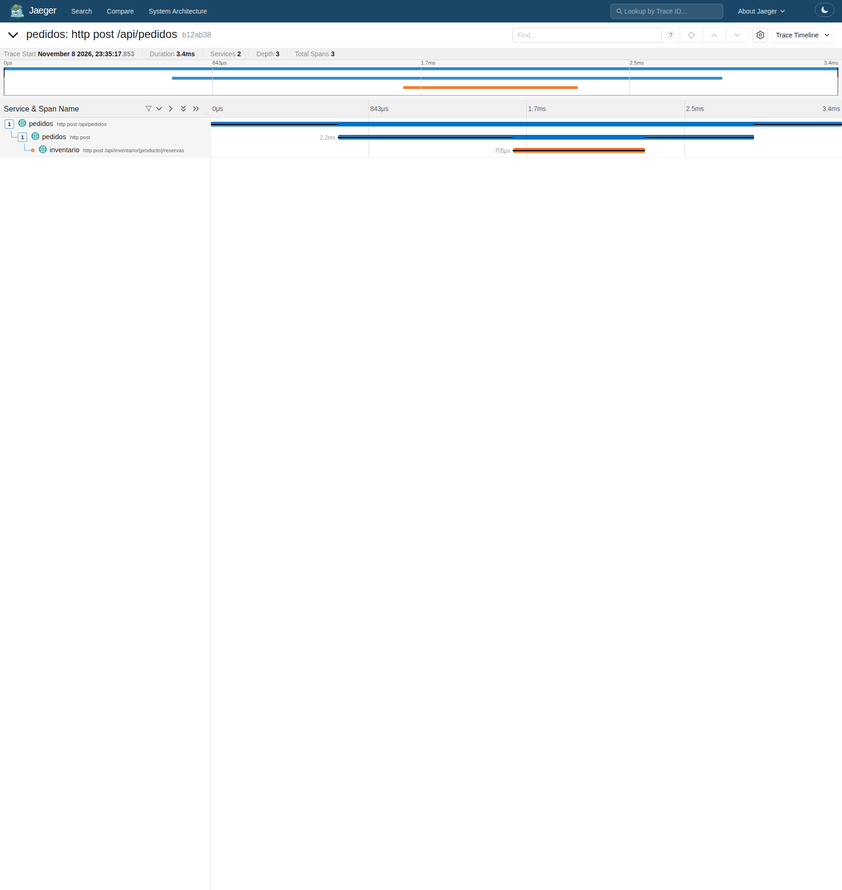
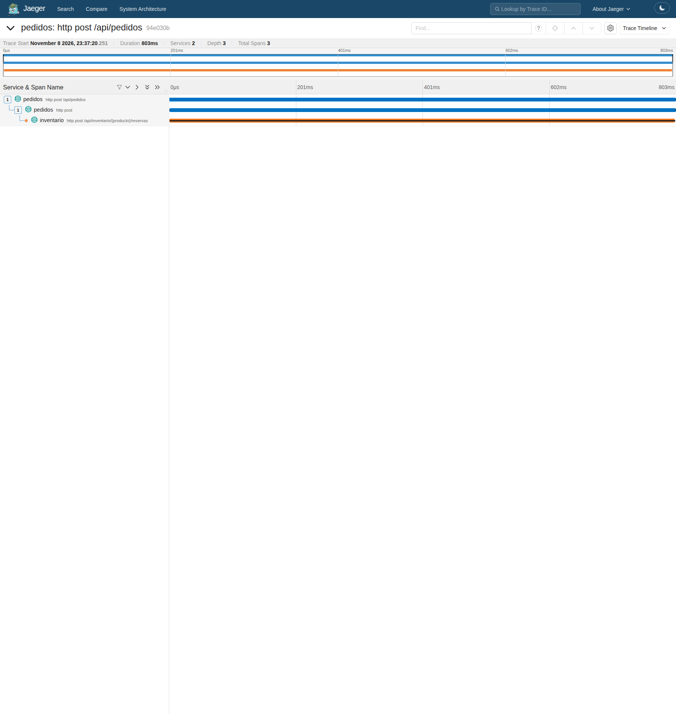
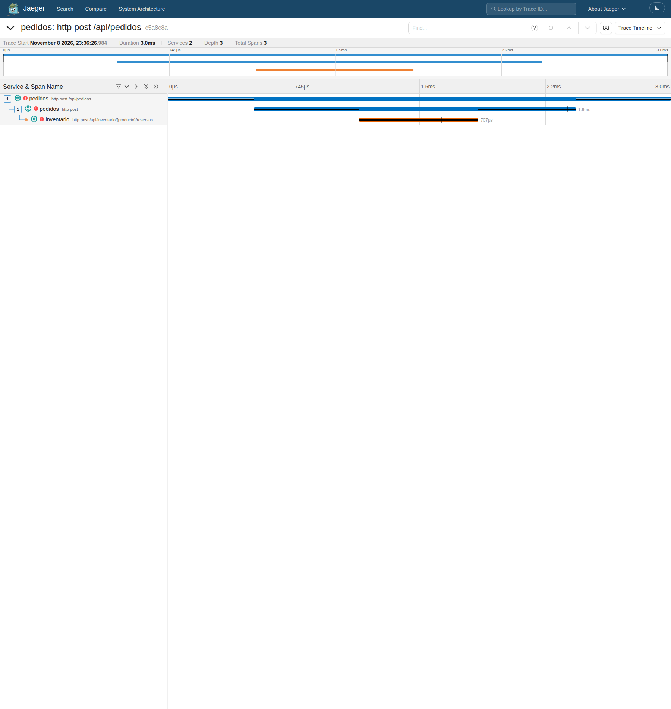

# Trazas distribuidas

**Ejecución verificada:** se conservaron trazas propias normal, lenta y fallida.
Cada una tiene tres spans, servicios `pedidos` e `inventario`, una raíz real y todas
las relaciones padre-hijo dentro de la traza. Las capturas no muestran el aviso
Incomplete; sus datos OTLP originales están versionados junto a las imágenes.

## Estructura verificada

Para `POST /api/pedidos`, se verificaron:

1. Un span servidor en `pedidos`, que representa la solicitud del cliente.
2. Un span cliente en `pedidos`, que representa la llamada HTTP de reserva.
3. Un span servidor en `inventario`, que representa la recepción de esa reserva.

El encabezado W3C `traceparent` relaciona esos spans dentro de una traza. Se comprobaron
el mismo traceId, los servicios de cada span y la relación padre-hijo, además del conteo.
La presencia de tres spans aislados no demuestra por sí sola una traza distribuida.

## Trazas medidas

| Escenario | traceId | Petición en pedidos | Reserva en inventario |
|---|---|---:|---:|
| Normal | `b12ab386b33ed1209b4e3b0d9d1186ee` | 3.373 ms | 0.705 ms |
| 800 ms artificiales | `94e030b34bb9cb4fc2937bf851dbae14` | 802.905 ms | 800.646 ms |
| Error simulado | `c5a8c8ae32a66fd74a32c9f4b1006845` | 2.982 ms | 0.708 ms |

La solicitud lenta tardó **802,905 ms** en pedidos y **800,646 ms** dentro de inventario.
La espera artificial se observa en el servicio responsable, y el span cliente de
pedidos permanece abierto esperando esa reserva. Los spans se solapan: sumarlos
contaría varias veces el mismo tiempo. La diferencia también incluye procesamiento
HTTP y ejecución; no es una medición aislada de la red.

Los pedidos normal y lento se enviaron sin inventar un padre de traza. Sus IDs se
recuperaron de la línea de confirmación del pedido real. La traza fallida se seleccionó
del log de una solicitud real de k6, y sus dos logs coinciden con el mismo traceId.

## Trazas y datos originales

Traza normal de los dos servicios

[Resumen de spans](https://github.com/ItsN3M3515/DYAS-Monitoreo/blob/main/evidence/runtime/trace-normal.json) · [Datos OTLP originales](https://github.com/ItsN3M3515/DYAS-Monitoreo/blob/main/evidence/runtime/trace-normal-otlp.json).

Traza lenta: el tiempo se concentra en inventario

[Resumen de spans](https://github.com/ItsN3M3515/DYAS-Monitoreo/blob/main/evidence/runtime/trace-slow.json) · [Datos OTLP originales](https://github.com/ItsN3M3515/DYAS-Monitoreo/blob/main/evidence/runtime/trace-slow-otlp.json).

Traza fallida: los tres spans marcados con error

[Resumen de spans](https://github.com/ItsN3M3515/DYAS-Monitoreo/blob/main/evidence/runtime/trace-error.json) · [Datos OTLP originales](https://github.com/ItsN3M3515/DYAS-Monitoreo/blob/main/evidence/runtime/trace-error-otlp.json).

## Recuperación y alcance

El simulador se restableció y ambas alertas volvieron a Inactive antes de terminar el
tráfico. El runner se apagó al finalizar el workflow, por lo que sus URLs localhost
no siguen disponibles. Las capturas y los datos permiten revisar esta ejecución;
para explorar nuevas trazas hay que volver a iniciar el laboratorio.
